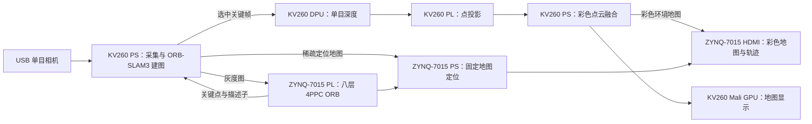

# 芯火启航：便携式单目建图与彩色地图定位系统

**全国大学生嵌入式芯片与系统设计竞赛 · 队伍编号 53996 · 2026 提交源码**

一个 USB 单目相机、KV260 与 ZYNQ-7015、一根板间网线，完成
**开始建图 → 结束并保存 → 自动地图交接 → 持续定位**。
设备自带电源和显示屏，建图与定位无需随身电脑。

## 当前系统

稀疏地图保存几何定位所需的点、描述子和观测；稠密彩色地图展示环境。
ZYNQ-7015 复用固定视角彩色背景，实时更新定位轨迹。
KV260 的 DPU 深度任务按关键帧调度，PS 负责尺度对齐、筛选与融合。

## 源码从哪里看

| 部分 | 主要入口 |
|---|---|
| ZYNQ-7015 自研 ORB HLS | [图像核与描述子核](orb60/optimized/FPGA_ORB_HLS/fastv2/next/src/) |
| ORB 接口、槽位、定点参考 | [include](orb60/optimized/FPGA_ORB_HLS/fastv2/next/include/)、[参考模型](orb60/optimized/FPGA_ORB_SHARED_v1.0/) |
| ZYNQ-7015 ORB＋HDMI 顶层 | [集成脚本](zynq7015_demo/scripts/synth_pl_2018.py)、[视频 RTL 与 XDC](zynq7015_demo/rtl/) |
| ZYNQ-7015 PS 定位与显示 | [demo_main.cpp](zynq7015_demo/src/demo_main.cpp)、[slam.cpp](zynq7015_demo/src/slam.cpp)、[ui.cpp](zynq7015_demo/src/ui.cpp) |
| KV260 PS 建图基础源码 | [ORB-SLAM3 适配树](review/kv260_slam_base/)、[适配与构建脚本](orb60/kv260/ps/) |
| 最终原生编译输入 | [摄像头手动入口与视频入口快照](review/final_native_sources/) |
| KV260 DPU 深度链 | [worker](orb60/dense/kv260/worker.py)、[MiDaS QAT](orb60/dense/kv260/midas_refine/)、[部署模型](assets/models/) |
| KV260 点投影 PL 核 | [point_project.cpp](orb60/kv260/point_pl/point_project.cpp)、[保留的硬件生成脚本](review/kv260_hardware_source/) |
| GPU 点云显示 | [GLES2 查看器](orb60/kv260/gles2_view.py) |
| 控制面板、自动交接与重连 | [manual_gui.py](orb60/kv260/manual_gui.py)、[manual_control.py](orb60/kv260/manual_control.py)、[启动服务](orb60/kv260/startup/) |
| 资源、时序和保存的实测记录 | [acceptance](review/acceptance/) |

**建议阅读顺序：**本页 → [源码与构建导航](docs/submission/SOURCE_AND_BUILD_ZH.md)
→ [依赖及模型说明](docs/submission/DEPENDENCIES_ZH.md) → 对应模块源码。

`orb60/baseline`、`orb60/experiments` 和 `rk3588` 是保留的历史基线与优化过程。
当前发行系统使用 KV260＋ZYNQ-7015，不需要 RK3588。
旧单板 ORB＋DPU 候选仍可审阅；当前 KV260 平台实际包含 DPU＋点投影核，ORB 位于 ZYNQ-7015。

## 使用方式

1. 两块板保持供电，USB 相机接 KV260，两板用网线连接。
2. 在 KV260 的“手动建图与定位”面板点击“开始建图”，缓慢平移扫描。
3. 点击“结束并保存”，系统保存最近更新的地图，并自动交接给 ZYNQ-7015。
4. ZYNQ-7015 持续定位并显示彩色环境和轨迹；需要重新扫描时再次开始建图。
5. “重启程序”用于重启应用；关闭或隐藏面板不结束持续定位。

本次源码同步包含保存地图持久化和无效旧地图的启动错误处理修复。
地图版本、相机参数和配套彩色地图保持关联，避免混用不同坐标系。

## 复核与许可

从仓库根目录执行 `python scripts/verify_submission.py`，检查文件 SHA-256、
核心源码入口及禁止公开的凭据。测试入口和硬件构建步骤见源码导航。
保存的板端记录保留原日期；本次整理没有重新开展板端实验或布局布线。

项目及 ORB-SLAM3 衍生部分采用 **GPL-3.0-or-later**，允许按协议复制、修改和再分发。
MiDaS/FastDepth 为 MIT；其他第三方保留原许可。见 [LICENSE](LICENSE)、
[许可范围](LICENSING.md) 和 [第三方声明](THIRD_PARTY_NOTICES.md)。
这里没有将 ORB-SLAM3 衍生代码改为 MIT/Apache-2.0。

模型权重、部署 xmodel 及哈希位于 `assets/models/`。AMD 工具、厂商 DPU IP、
板卡系统镜像、SSH 密钥、密码、电子签名和参赛授权书不包含在公开仓库中。
代码提交包与本分支源码由 `SOURCE_SNAPSHOT_SHA256.json` 绑定。
